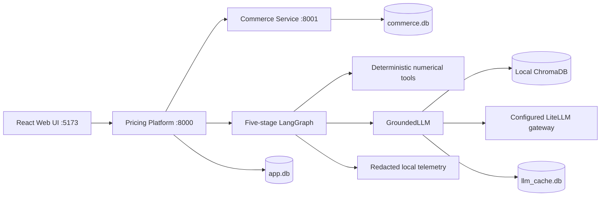

# Technical Design

- **Product:** AI-Driven Dynamic Pricing Engine for Retail
- **Status:** Draft proposal for review; no implementation or PRD approval is implied
- **Source:** [prd.md](prd.md), version 1.1, dated 2026-08-07
- **Prepared:** 2026-11-08
- **Related documents:** [requirement.md](requirement.md), [task.md](task.md)

## 1. Design authority and scope

The PRD defines required behavior. This document proposes implementation details where the PRD is silent; endpoint names, module names, equations, scheduling semantics, and configuration formats below are proposals. Requirement IDs refer to the PRD. Its referenced source documents and complete Phase 1 decision log are not present in this repository, so no additional constraints are inferred from them.

The design serves a local, single-user demonstration. It includes synthetic commerce data, deterministic pricing and compliance, five agent stages, grounded explanations, bounded autonomy, human review, scenario simulation, outcome learning, and an explicitly started interval loop. Production authentication/RBAC, real commerce integrations, consumer-level pricing/data, cloud deployment, containers, system daemons, brokers, deep learning, mobile-native apps, multi-currency tax handling, and autonomous agent negotiation remain out of scope.

## 2. Fixed architecture and invariants

| Component | Address | Authority and persistence |
|---|---|---|
| Commerce Service | `localhost:8001` | Catalog, sales transactions, inventory, current prices, and price history in `commerce.db` |
| Pricing AI Platform | `localhost:8000` | Runs, recommendations, policy versions, decisions, audit, feedback models, settings metadata in `app.db`; LLM cache in `llm_cache.db`; embeddings in `./data/chroma` |
| Web UI | `localhost:5173` | React, React Router, Vite, Tailwind; calls Platform only; local theme preference |
| LiteLLM gateway | Configured URL/port | Backend-only chat model access through LangChain `init_chat_model` |
| Embedding engine | In-process by default | Local `all-MiniLM-L6-v2`; gateway fallback requires the decision in §16 |

Proposed HTTP servers use an asynchronous Python framework with Pydantic boundary schemas. Python runs in `venv`; Node must satisfy the PRD's `>=20.19`, with 22.x LTS preferred. Exact compatible package versions are selected and locked during implementation, not assumed here.



Enforce these invariants in architecture checks and shared dispatch code:

1. Platform accesses Commerce business data exclusively over HTTP; neither service imports the other's implementation or opens its database (FR-003, FR-051, NFR-031).
2. Elasticity regression precedes Monte Carlo; its distributions precede constrained optimization. LLMs cannot supply numeric prices, rule verdicts, bands, or execution permissions (FR-012, FR-017, FR-030, FR-080–081, FR-089).
3. Every LLM call uses `GroundedLLM`; every recommendation has valid source citations. Execution has no LLM dependency (FR-023, FR-040, FR-043).
4. Compliance veto applies to every mode, override, push, and revert. Human and automatic approvals use the same final validation and push implementation (FR-033, FR-053, NFR-040).
5. Audit writes are part of decision persistence; telemetry export is asynchronous and cannot fail a run (FR-059, NFR-015, NFR-025).
6. Boot defaults to Supervised and loop stopped. No automatic write intent resumes merely because a process restarts (FR-101, FR-122).

## 3. Proposed repository structure

```text
commerce/
  api/                 # HTTP routes and boundary schemas
  domain/              # Independent commerce validation and price application
  storage/             # commerce.db migrations and repositories
  seed/                # Synthetic data generator; evaluator-only truth fixture
platform_app/
  api/                 # UI API routes, progress streams, A2A adapter
  agents/              # Five node adapters and graph assembly
  schemas/             # Typed graph state and application contracts
  tools/               # Deterministic analysis, rules, stability, optimizer
  services/            # Run, review, dispatch, scheduler, feedback, scenario services
  rag/                 # Upload ingestion, retrieval, source validation
  llm/                 # GroundedLLM, model roles, output repair, cache
  prompts/             # Versioned role prompts
  storage/             # app.db and llm_cache.db repositories/checkpoints
  telemetry/           # Redaction, structlog, callbacks, cost accounting
  shared/              # Configuration, TLS, clock, identifiers, HTTP errors
web/src/
  app/                 # Router, persistent shell, semantic theme tokens
  features/            # Runs, review, simulation, dashboards, audit, settings, RAG
  components/          # Tables, distribution charts, accessible status controls
  api/                 # Platform client and progress subscriptions
contracts/             # Versioned wire schemas/fixtures; no cross-service imports
tests/                 # Unit, contract, integration, UI, architecture, performance
data/                  # Local runtime files; excluded from source control
startup.sh
startup.bat
```

Modules use composition and narrow responsibilities. Apply the PRD's 300–400 LOC guideline as a hard 400-line maximum for implementation code files, aiming below 300 LOC; documentation is not an implementation module. Do not make small code changes harder by building inheritance hierarchies (NFR-030–034). Contract fixtures may be shared as artifacts while each service validates independently.

## 4. Five-agent execution and state

| Stage | Deterministic responsibility | Permitted LLM contribution |
|---|---|---|
| Data & Context | Concurrent HTTP/feed/retrieval operations; normalization, quality gates, competitive gaps, stock cover/velocity | Narrate anomalies and synthesize competitive positioning with citations |
| Quantitative | Regression, sample sufficiency, uncertainty sampling, per-price distribution summaries | Interpret elasticity, uncertainty, and caveats |
| Strategy & Reasoning | Call optimizer over computed distributions and constraints | Explain the selected decision, conflicting signals, and assumptions |
| Validation & Compliance | Rules, oscillation, convergence, anomaly checks, deterministic confidence/bands | Explain violations only |
| Execution | Idempotent push, outcome reconciliation, audit, readback | None |

Roles map through configuration: `router` and `narrator` to cheapest flash-lite, `analyst` to flash, `strategist` to pro; concrete aliases are validated against the gateway at boot. Agent 1 uses narrator/analyst, Agent 2 analyst, Agent 3 strategist, Agent 4 strategist for explanation. Optional chat uses router. Code does not hardcode model IDs (PRD §4.3).

Proposed typed `RunState` includes `run_id`, scope/objective/constraints, source versions and timestamps, quality results, retrieval references, elasticity/model versions, simulation configuration/seed, candidate distributions, recommendation IDs, rule/stability results, band reasons, policy/mode versions, approval references, push results, and typed errors. Credentials are never checkpointed.

Run lifecycle: `created → ingesting → quantifying → strategizing → validating → awaiting_review/executing → completed`. `failed`, `interrupted`, and `cancelled` are explicit states. A run may have completed automatic items while other items await human review; persisted per-item states and counts are authoritative, rather than a single status hiding partial progress.

Proposed recommendation lifecycle: `proposed → validated → pending_review / pending_escalation / auto_approval_pending → approved → push_pending → applied / rejected_by_commerce / push_unknown`. A rule failure instead produces `blocked_compliance`; rejection produces `rejected_by_user`. A manual override creates a new immutable revision linked to the original and returns through simulation, grounding, and validation as applicable. Original evidence is retained.

The review boundary is a persisted LangGraph interrupt. Human approval is server-validated and resumes only the selected eligible items; no UI-only gate or client-supplied approval flag is trusted. Graph checkpoints are committed after each node and before/after external side effects. Resume is explicit, reloads current policy/mode, checks source freshness, and reconciles unknown push results before any dispatch (NFR-024).

### 4.1 Ingestion and quality failure

Agent 1 starts sales/catalog/current-price fetch, competitor fetch, inventory analysis, and RAG retrieval concurrently using bounded asynchronous tasks. Inventory computation awaits its own prerequisite payload without serializing unrelated paths (FR-077). Each produces data/provenance or a typed failure. Apply freshness, completeness, schema, referential integrity, and outlier checks, recording severity, affected counts, thresholds, and remediation.

A required Commerce failure or failing quality gate halts the run before numeric pricing. A recoverable optional path failure can continue only when the quality gate passes, valid grounding remains available, and all missing inputs are explicitly represented in simulation assumptions/confidence. Never replace a missing causal estimate or citation with fabricated certainty. FR-079's degraded operation does not override FR-011 or NFR-026; exact required/optional source classifications need calibration (§16).

## 5. Deterministic numerical design

### 5.1 Synthetic data and elasticity

Generate repeatable category/product-family catalogs, costs, bounds, stock, competitor prices, promotions, seasonality, and sales using seeded ground-truth SKU elasticities (FR-001–002). Keep ground-truth parameters in an evaluator-only fixture or Commerce-owned evaluation storage; ordinary training/recommendation payloads exclude them. Synthetic future outcome generation remains Commerce-owned.

Proposed regression uses aggregated SKU/time observations, a log-price response model, and explicit seasonal/promotion controls. Report coefficient, interval level/bounds, effective sample size, diagnostics, and model version; zero sales, invalid prices, stockouts, promotions, missing values, and outliers require documented treatment. Deterministic fitting alone does not prove causal identification: synthetic generation and controlled evaluation must verify recovery of the known response. Insufficient or poorly identified history caps confidence and disqualifies the Auto-approve band (FR-012–014). Review-band behavior still follows the active mode, including the Autonomous hold-window policy.

### 5.2 Monte Carlo engine shared with scenarios

Input contract: SKU/model version, elasticity estimate and uncertainty distribution, baseline demand/price, candidate prices, cost and inventory, competitor/seasonal distributions, horizon, seed, sample count, and stress configuration. All four uncertainty inputs are mandatory in the contract: elasticity, competitor response, cost drift, and seasonal variation (FR-080–087).

An illustrative demand equation is `Q_s(P) = Q0 × (P/P0)^elasticity_s × seasonal_s × competitor_response_s`, with a separately documented residual term if needed. Apply explicit demand/inventory limits and compute `revenue_s = P × sold_units_s`, `gross_profit_s = (P − cost_s) × sold_units_s`, and `margin_rate_s = (P − cost_s)/P`. Cost units, rounding, stockouts, replenishment assumptions, horizon, and quantity truncation are recorded rather than hidden. The fitted model ultimately determines the equation; this illustration is not a PRD-mandated formula.

For each candidate emit demand/revenue/gross-profit/margin/stock-cover distributions, median and configured interval bounds, variance, expected uplift against current price and baseline, and empirical probability of margin-rate below the floor. Keep the point-in-time deterministic compliance verdict separate from stochastic future cost risk. Interval level is configurable and always displayed; the PRD does not prescribe 90% or 95%.

Use deterministic per-run/per-SKU/per-input stream seeds derived from a stored seed and stable identifiers. Store engine version, input hashes, parameters, and summaries needed to reproduce results; identical inputs/seed/version produce identical numeric output regardless of worker scheduling. This guarantee concerns simulation, not newly generated LLM prose. Candidate comparisons use common random draws to reduce noise. Run-level intervals come from jointly aggregated scenario draws, preserving modeled shared shocks; do not sum individual interval endpoints.

Vectorize bounded numerical batches and execute CPU-bound work in a bounded executor/process pool within application lifespan; it must not block async HTTP/SSE handling. Configurable iteration counts and candidate-grid resolution are calibrated against the 60-second Monte Carlo budget for 500 SKUs and five-second single-SKU simulation target, with measured accuracy/runtime trade-offs (NFR-010, NFR-037–038).

### 5.3 Optimizer, stability, and confidence

The proposed optimizer searches a deterministic candidate grid using an explicit normalized objective combining expected revenue and gross profit. Revenue-weighted, margin-weighted, and balanced presets define inspectable weights. Baselines and objective normalizers must be fixed per run to make comparisons meaningful. Any added risk penalty is a visible proposed configuration, not an unstated PRD requirement.

Candidate feasibility includes MAP/margin floors, category bounds, maximum change, run constraints, price tick/round-number policy, family ladders, and damping. Family constraints require a feasible joint assignment; independently optimal SKU prices cannot be pushed if their combination breaks a ladder. Deterministic tie-breaking makes repeated runs reproducible. If no feasible price exists, record an unpriceable item with reasons; do not fabricate a recommendation.

Preload price history for stability checks. For suspected oscillation constrain the move toward a candidate using a configured damping factor, then evaluate the resulting feasible price through the same simulation/optimizer path. The Validation node recomputes and persists final oscillation/anomaly signals; damping does not erase the Escalate trigger. Optional minimum-change interval holds are enforced on both approval paths (FR-088, FR-090–095).

Compute confidence deterministically from elasticity uncertainty/sample sufficiency, simulation variance, quality, competitor freshness, and observed forecast error; persist component values, formula/version, and caps (FR-021, FR-109). LLM qualitative interpretation cannot increase this score or change the resulting band.

Implement a cost-plus/category-discount baseline on the identical source snapshot, horizon, and evaluation assumptions. Evaluate both forecasts under the same numerical engine and ground-truth optimum where available; isolate baseline parameters from AI tuning (FR-049, FR-057).

## 6. Rules, bands, approvals, and dispatch safety

### 6.1 Compliance and band algorithm

Each deterministic rule returns `rule_id`, version, pass/fail, actual values, limits, affected SKUs, and reason. Ship MAP floor, margin floor, max-change percentage, family ladder, category bounds, and round-number rules. Persist every evaluation. Rule configuration is versioned and editable without code changes when FR-032 is included. Uploaded prose policy informs explanations; only validated structured rule configuration enforces prices. An LLM cannot silently convert a document into executable policy.

Band precedence is deterministic:

1. Any compliance failure, margin proximity, excessive variance, oscillation, or out-of-history market condition assigns **Escalate**.
2. Otherwise all auto conditions must pass: confidence strictly above its configured threshold, delta within limit, clean compliance, variance within limit, no oscillation, sufficient elasticity samples. Assign **Auto-approve**.
3. Otherwise assign **Review**.

Persist all reasons with actual values, thresholds, and policy version, even when several triggers fire. A statistical recommendation anomaly is visible independently of rule failures; how it maps to “outside historical norms” is an explicit threshold decision. Exact comparisons at boundaries are configuration/test cases, not hidden floating-point behavior.

Compliance-failing Escalate items cannot be approved or force-pushed. A revised compliant price is a new recommendation. Other Escalate items require explicit human override and a non-empty written reason; override does not waive any rule. Bulk approval accepts only actual Review-band items above the bulk threshold with clean compliance, even when Supervised routes Auto-approve items into the human queue (FR-024–025).

### 6.2 Mode policy

| Mode | Auto-approve band | Review band | Escalate band |
|---|---|---|---|
| Supervised, default | Human decision | Human decision | Explicit human override; compliance veto remains |
| Assisted | Automatic approval and dispatch | Human decision | Explicit human override; compliance veto remains |
| Autonomous | Automatic approval and dispatch | Automatic only after configured hold, absent human intervention | Explicit human override; compliance veto remains |

Band is a risk classification; mode is dispatch policy. Store mode and version at recommendation decision, approval, and dispatch so later changes cannot rewrite history (FR-101–104). Pending automatic intent is reconsidered under current mode immediately before dispatch. A mode downgrade cancels newly ineligible pending automatic approvals; an upgrade does not silently revive previously cancelled intents without a fresh decision.

### 6.3 Kill switch and common execution path

One confirmed action atomically sets Supervised, marks loop stop requested, increments a dispatch generation, cancels pending automatic/hold-window intents, and appends the audit event. Both scheduler and dispatcher observe the generation before claiming new work. Reject stale approval/dispatch versions and serialize overlapping per-SKU changes.

Automatic and human approvals call one dispatcher, which rechecks current policy, commerce price version, freshness, compliance, holds, approval revision, and audit persistence before creating a durable push intent. Persist prior price, idempotency key, exact payload digest, and approval actor before sending HTTP. An in-flight request may already have committed at Commerce; mark its state and reconcile rather than claiming the kill switch recalled it. Exact in-flight semantics require the decision in §16; no unsent pending automatic item may dispatch after the kill is acknowledged.

Revert creates a compensating price-change request using the stored prior price, with one user action, the same independent validation, a new idempotency key, and linked audit history. Do not delete the original push. A newer price version or newly invalid prior price must surface a conflict/rejection; compliance remains absolute (FR-098, NFR-039–040).

## 7. Commerce HTTP contracts and idempotency

Proposed Commerce routes are `GET /health`, `GET /catalog`, `GET /sales`, `GET /inventory`, `GET /prices`, `GET /price-history`, `POST /prices/batches`, and `GET /prices/batches/{batch_key}`. Reads support SKU/category/time filters, pagination, `as_of`, and source/price versions for auditable snapshots. The synthetic competitor adapter implements the same `CompetitorFeed` protocol an optional disabled live adapter would use.

Batch request: `batch_key`, `request_id`, `run_id`, and items containing `recommendation_id`, SKU, proposed monetary price, currency, expected current price/version, approval kind/actor, and policy metadata. Monetary values cross HTTP as decimal strings or integer minor units; binary floats are not authoritative price storage. Timestamps use UTC with timezone-aware display.

Commerce independently validates schema, SKU existence, currency/precision, expected version, and applicable pricing rules against its current catalog/cost/policy. It also checks proposed family prices as a coherent set. Within a database transaction, reserve the unique batch key, validate a canonical payload digest, apply accepted items, append price history, and persist per-item outcomes. Reject a reused key with a different payload as a conflict; a repeated identical request returns its stored outcome without reapplying. Items violating a coupled family constraint are rejected together as needed so partial application cannot create an invalid ladder.

Response includes batch status plus every SKU's `applied/rejected`, prior/new price/version, applied timestamp, and rejection code/message. A transport timeout is `push_unknown`, not failure: look up the same key or replay the identical request. Never retry with a new key. Commerce rejection is authoritative and visible per SKU (FR-051–054).

## 8. Proposed Platform API and streaming

| API group | Proposed routes and behavior |
|---|---|
| Health/configuration | `GET /api/health`, `GET /api/settings`, `PATCH /api/settings`; read responses contain configured/masked key status only |
| Runs | `POST /api/runs`, `GET /api/runs`, `GET /api/runs/{id}`, `POST /api/runs/{id}/resume`, `GET /api/runs/{id}/events` |
| Review | `GET /api/recommendations`, detail endpoint, `POST .../{id}/approve`, `/reject`, `/override`, bulk-approval endpoint with per-item eligibility results |
| Execution | `POST /api/pushes`, `GET /api/pushes/{id}`, `POST /api/recommendations/{id}/revert` |
| Modes/policy | `GET/PATCH /api/autonomy`, `POST /api/kill-switch`, versioned rule/threshold endpoints |
| Scenarios | `POST /api/scenarios/simulate`, optional save/name/list endpoints, comparison endpoint using identical assumptions |
| Optional conversation, C | `POST /api/chat`; read-only questions about recommendations using router role and `GroundedLLM`, with citations and no approval/price-write tools (FR-029) |
| Grounding | `POST /api/grounding/uploads`, upload-status endpoint, `GET /api/grounding/collections` |
| Dashboards/audit | `GET /api/metrics/...`, `GET /api/audit`, per-SKU timeline and optional export |
| Loop | `POST /api/loop/start`, `POST /api/loop/stop`, `GET /api/loop`, iteration-history endpoint |
| Telemetry | `GET /api/telemetry/summary`, persistent global event stream for call/token/cost/cache/loop/mode changes |
| Optional A2A | `GET /.well-known/agent-card.json`, JSON-RPC endpoint supporting only `message/send` and `tasks/get` |

Long operations return an operation/run ID promptly. Server-sent events carry monotonically increasing event IDs, run ID, stage, item counts, status, and timestamps; reconnect uses the last event ID or reloads a persisted snapshot. Streaming is informational; disconnecting the browser does not approve a recommendation or cancel a run. Typed errors include machine code, user-facing reason, affected IDs, retryability, and correlation ID, with no secret-bearing stack traces.

## 9. Persistence and audit model

| Store | Proposed records |
|---|---|
| `commerce.db` | Products/families/categories, aggregated synthetic sales, stock, live prices, price history, batch keys/digests/results, Commerce policy versions |
| `app.db` | Runs, checkpoints/events, source manifests, quality verdicts, elasticity/model versions, simulation summaries/configurations, recommendation revisions, rule/stability/band evaluations, approvals, push intents/results, scenarios, feedback windows/adjustments, loop sessions/iterations, policy/settings metadata, append-only audit |
| `llm_cache.db` | Exact/semantic request metadata, context/version fingerprints, validated structured responses, expiration/access metadata, aggregate hit/miss counters |
| ChromaDB | `pricing_policy`, `market_intel`, `product_kb`, `user_uploads`; document/chunk IDs, versions, source metadata, embeddings |

Enable WAL for `app.db` and `llm_cache.db`, busy timeouts, foreign keys, short transactions, serialized migrations, and bounded writers. Do not keep transactions open during LLM/HTTP/numerical work. A durable local outbox/push-intent table bridges the non-transactional HTTP boundary without pretending the two databases share a transaction.

The Platform owns derived artifacts and immutable evidence, not a mutable replica/system of record. Proposed source manifests retain content hashes, source timestamps/versions, and minimum evidence snapshots required for replay and audit. Full raw sales/catalog retention needs the explicit interpretation in §16 because the PRD also says “owns no business data.”

Audit events include immutable event ID, UTC time, actor (`human` identity label or `system`), action, run/SKU/recommendation revision, source/model/seed references, rule/band results, prior/new values, reason, decision/approval/dispatch mode, and outcome. Application repositories expose insert/read only; database protections reject audit updates/deletes. Corrections append linked events. Local append-only enforcement is not a claim of resistance to a machine administrator editing the SQLite file.

## 10. GroundedLLM, output validation, and cache

`GroundedLLM` owns redaction, role/model resolution, retrieval, context/source injection, cache lookup, structured generation, citation validation, repair, telemetry, and sanitized cache writes. Restrict provider initialization/imports to this module boundary and fail an automated architecture check when another module bypasses it.

Embedding and retrieval are deterministic service interfaces beneath the grounding wrapper, not additional generative agents. Query embedding must not recursively invoke grounded generation. If gateway embedding fallback is approved, route its backend transport through the same centralized secret/TLS/redaction boundary while preserving this nonrecursive dependency.

All application-logic calls use `.with_structured_output(Model, method="json_schema")`. On schema/citation validation failure allow exactly one repair call containing validation errors and the same grounded source context, then return a typed error; no raw `json.loads` on model output. Recommendation narration references immutable numerical artifact IDs; application code attaches prices, intervals, scores, and verdicts from those artifacts and rejects conflicting model-supplied values. Retrieved documents are evidence, not instructions that can alter system rules or tool permissions. Gateway transient retries are a separate bounded transport policy, with exponential backoff for 429/500/502/503/504, cancellation awareness, and finite budgets (NFR-021).

Retrieval includes versioned sources with resolvable IDs. Validate citations against the actual context supplied, not merely a non-empty list. Role-specific breadth limits token cost while preserving grounded calls. Successful runtime upload atomically publishes document/chunk metadata and a new corpus version after embedding completes; failed uploads do not appear as ready. Subsequent reasoning includes the `user_uploads` collection in mandatory retrieval/context policy and invalidates old-context cache matches. The literal requirement to include every uploaded document on every call needs clarification for large corpora (§16).

Exact keys include redacted prompt, role/model, generation settings, schema/prompt versions, deterministic numeric input hashes, retrieval chunk IDs/content hashes, corpus/policy versions, and locale where relevant. Semantic matching is allowed only within the same exact safety namespace and a calibrated similarity threshold; different prices, data snapshots, rules, evidence, or output schemas cannot reuse a superficially similar recommendation. Revalidate any cache hit against schema/citations. SQLite persists both tiers; local embeddings support semantic matching. Apply expiry and expose hit/miss/latency counts (FR-073).

## 11. Outcome learning and continuous loop

Execution records push time and price version, then later reads realized sales through Commerce HTTP for an explicit observation window/horizon. Compare only completed, comparable windows; label insufficient follow-up and confounding promotions/stockouts. Record forecast intervals, realized outcomes, baseline comparison methodology, forecast error, and inclusion/exclusion reasons.

Refine elasticity with new post-change evidence and cap each adjustment using a versioned configured maximum. Persist before/after values, cap applied, evidence window, algorithm version, and reason. Refine Monte Carlo input distributions from observed error with minimum samples, variance floors, bounded adjustments, and drift warnings. Intervals may widen under new uncertainty; do not tighten mechanically to meet a metric. Feed realized forecast error into confidence. Show per-SKU/run convergence trends and a warning when forecast-versus-realized uplift errors widen (FR-055, FR-092, FR-107–111).

The loop is one cancellable in-process lifespan task, started only by explicit UI action. Proposed state: `stopped → running → stopping → stopped`, with `failed` on any failed iteration. Store scope, interval, optional max iterations, mode/policy snapshots, iteration decisions, counts, next-run time, and stop/error reason.

Use one active loop session and non-overlapping iterations. Proposed fixed delay starts the next timer after the previous iteration finishes; UI distinguishes configured delay from expected next run. Optional max-iteration limit stops cleanly. Each iteration runs W1, takes current policy/mode, and uses the shared dispatcher. A failure stops future scheduling and raises a persistent visible error; bounded transient gateway retry within an iteration is not permission to restart a failed iteration silently. Awaiting human review pauses that graph branch but need not block safe automatic branches; prevent new overlapping pending recommendations for the same SKU (§16).

On shutdown stop scheduling and dispatch, cancel/complete in-flight tasks within a bounded grace period, checkpoint interrupted runs, reconcile unknown writes on the next explicit resume, flush local telemetry, and close databases. Historical loop sessions persist, but restart always has the loop off and mode Supervised (FR-121–127, NFR-023–024, NFR-035–036).

## 12. UI design

Use an enterprise desktop layout with a persistent shell and routes for run creation/history, review, simulation, performance/baseline, stability/autonomy, and audit. Show quality results before recommendations. Review supports the required filters/sorts, keyboard navigation, per-item actions, eligible bulk approval, visible auto-approved history, and detailed evidence/ladder views where included. Band labels/shapes accompany colors (FR-026–028, FR-070, FR-118).

The global header always shows mode control, distinct kill switch with one confirmation, loop-running indicator, active LLM calls, cumulative input/output tokens, and estimated cost. The global settings gear opens URL/port/key input, an iOS-style “Disable SSL Verification” toggle, and live cache counts. The grounding panel exposes collection document/chunk counts, last update, upload progress/errors, and runtime upload. Loop controls expose scope, delay, start/stop, iterations, next-run time, and live decisions (FR-065–068, FR-115–120).

Scenario screens show demand/revenue/margin/stock-cover distribution charts with interval level, assumptions, below-floor probability, baseline/AI comparisons, and optional named scenarios, narration, and stress tests. Dashboards show realized/forecast impact, acceptance, stability, convergence warnings, band distribution, escalation reasons, and mode history. Audit filters automatic approvals explicitly.

The could-have conversational panel asks grounded, read-only questions about existing recommendations and links answers back to their evidence/detail views. Its omission does not change the required review workflow; including it does not add a second approval channel (FR-029, C).

Use Lucide vector icons and no UI emojis. Define semantic CSS variables and Tailwind tokens for both light and dark themes, persist an explicit theme toggle, and verify distribution chart contrast and status accessibility in both. Target responsive operation from 1280px; no mobile-native scope is added (FR-062–064, FR-070, FR-119).

## 13. Settings, security, TLS, and startup

Keep gateway keys in backend memory; never return them in settings responses, checkpoints, traces, caches, files, or browser storage. Proposed UI key entry is write-only and clears immediately after submission; reconcile this unavoidable browser-entry transient with the literal wording in §16. Bind the local demo services to loopback, constrain browser origins, and reject consumer/PII fields at upload/API boundaries. Redact secrets/PII before prompting, caching, logging, and tracing; send only necessary retail aggregates to the configured gateway (FR-036–037, FR-072, NFR-011–014).

One TLS helper first uses `SSL_CERT_FILE` / `REQUESTS_CA_BUNDLE`. Verification stays enabled unless `ALLOW_INSECURE_TLS=true` explicitly permits the runtime toggle. Active bypass emits a prominent boot/runtime warning and persistent UI indicator; it removes certificate authentication and is restricted to the PRD's sanctioned corporate-network prototype context. Any Node `NODE_TLS_REJECT_UNAUTHORIZED=0` setting is confined to the Vite dev proxy, never production output (NFR-016–020).

Version runtime settings and swap validated backend clients atomically. In-flight requests retain their captured config; subsequent requests use the new config. Gateway URL/port/model aliases and nonsensitive settings may persist, but keys do not. Failed validation keeps the last working configuration and returns an actionable error.

`startup.sh` and `startup.bat` validate venv/Python, Node requirement, environment schema, writable SQLite/Chroma locations, port availability for 8000/8001/5173, embedding availability, TLS, gateway reachability, and configured model aliases. List real available aliases when mappings fail. Start Commerce and await health before accepting pricing runs; then start Platform and UI. Scripts clean up their own child processes and never install services, require root/admin, or invoke containers (FR-074–076, NFR-001–005, NFR-022).

## 14. Observability and performance design

Emit structured `structlog` JSON with correlation/run/agent/call IDs, latency, model, tokens, cache outcome, and error category. Maintain the always-on redacted local JSONL sink. Export Langfuse callbacks through a bounded, nonblocking path; its failures never fail pricing. Do not send proprietary prompt bodies/sales data to Langfuse; use sanitized metadata and local evidence references to satisfy NFR-014. If fallback telemetry itself fails, retain business audit separately and surface operator health without breaking a valid run.

Accumulate input/output tokens, active calls, estimated cost, and cache statistics per call/agent/run/session. Use configured gateway rates or LiteLLM fallback pricing and label unknown estimates. Cache hits record reuse separately from new token spend. Emit node progress and loop/mode events while numerical workers run.

Validate end-to-end on a documented developer-laptop profile, fixed 500-SKU data, seed, model mappings, and cold/warm cache conditions. PRD §6 uses “within” limits while §9 uses strict `<`; use the stricter `<300s` full-run and `<60s` Monte Carlo release checks. Cached responses must be `<100ms`, interactive feedback within 500ms, and single-SKU simulation within five seconds. Batch LLM narrative work with bounded concurrency rather than assuming 500 serial model calls fit the budget. Human waiting time is measured separately from active computation. Document warm-up and remote gateway latency honestly.

## 15. Validation and release mapping

| Milestone | Design areas | Required evidence |
|---|---|---|
| M1 Foundation | §2–3, §7, §13 | Both services/startup healthy, synthetic reproducibility and truth isolation, boundary enforcement, model/TLS/preflight failures |
| M2 Analysis core | §4.1–5 | Quality failures halt; regression recovers truth; Monte Carlo consumes elasticity and all uncertainty inputs; fixed-seed reproducibility; feasible optimizer/baseline; numerical runtime |
| M3 Orchestration | §4, §10 | Five stages, concurrent ingestion, persisted graph interrupt/resume, structured repair then typed failure, valid citations and wrapper-only access |
| M4 Safety/autonomy | §6, §9, §12 | Every shipped rule vetoes in all modes and override paths; band boundaries, damping/history, bulk restrictions, mode/kill races, append-only audit |
| M5 Integration/learning | §7, §11 | Duplicate-batch no-op, payload conflict, partial rejection and coupled constraints, timeout reconciliation, compliant revert, comparable realized windows, bounded feedback, shared scenario engine |
| M6 UI completion | §8, §12–14 | Persistent controls/monitor/RAG, light/dark charts and labels, review keyboard access, settings without secret leakage, dashboards and progress |
| M7 Loop/hardening | §10–11, §13–14 | Boot loop off, no overlap, failure stops loop, shutdown/resume safety, cache safety/latency/hit rate, retry budgets, telemetry outage isolation, optional A2A contract |

Measure PRD §9 targets using fixed evaluation data and explicit denominators: forecast uplift ≥5% with no margin degradation; high-confidence price accuracy within 10% of truth optimum; acceptance ≥70%; Assisted auto-approval ≥60%; escalation precision ≥80%; realized impact inside stated intervals ≥80%; oscillating SKUs <2%; narrowing forecast-error trend. Technical targets include ≥40% repeated-run cache hit rate, ≥99% valid output after repair, 100% cited recommendations/reproducibility, and zero compliance leaks, weaker automatic-path checks, duplicate applications, post-failure loop iterations, or source files over 400 LOC. Targets are validation goals, not guaranteed outcomes of this proposed design.

### 15.1 Requirement-to-design traceability

These groups cover every FR-001–FR-127 and NFR-001–NFR-040. Individual requirement priorities and acceptance criteria remain in [requirement.md](requirement.md); grouping here does not raise optional scope to must-have.

| PRD requirement IDs | Design sections |
|---|---|
| FR-001–FR-011, FR-077–FR-079 | §4.1 ingestion/quality, §5.1 synthetic data, §7 Commerce/feed boundary, §12 quality UI |
| FR-012–FR-021, FR-080–FR-088 | §5 regression, Monte Carlo, optimizer, deterministic confidence, baseline |
| FR-022–FR-029, FR-096–FR-098 | §4 recommendation revisions, §6 review/revert, §8 API/chat, §10 output validation, §12 review UI |
| FR-030–FR-037, FR-089–FR-095, FR-099–FR-104 | §5.3 stability/confidence, §6 compliance/bands/modes/kill, §9 audit, §13 privacy |
| FR-038–FR-044 | §9 collection persistence, §10 grounding wrapper/retrieval/uploads, §12 grounding UI |
| FR-045–FR-050, FR-105–FR-106 | §5.2 shared simulation engine, §8 scenario API, §12 scenario UI and optional narration/stress/comparison |
| FR-051–FR-055, FR-107–FR-111 | §6.3 dispatch, §7 Commerce contracts, §9 persistence, §11 readback and bounded feedback |
| FR-056–FR-061, FR-112–FR-114 | §9 audit model, §11 error/convergence, §12 performance/baseline/stability/autonomy/audit UI |
| FR-062–FR-070, FR-115–FR-120 | §8 events/settings API, §12 persistent shell and UI, §13 runtime configuration, §14 monitor |
| FR-071–FR-076 | §2 gateway boundary, §8 optional A2A, §10 cache, §13 startup/preflight and health |
| FR-121–FR-127 | §6.3 kill interaction, §8 loop API, §11 loop lifecycle and shutdown, §12 controls |
| NFR-001–NFR-005 | §2 local topology, §3 structure, §9 SQLite separation/WAL, §11 in-process loop, §13 startup |
| NFR-006–NFR-010, NFR-037–NFR-038 | §4.1 concurrency, §5.2 bounded numerical workers, §8 progress, §10 cache, §14 performance |
| NFR-011–NFR-015 | §6 shared validation, §9 append-only audit, §10 redaction, §13 secrets/privacy, §14 metadata-only egress |
| NFR-016–NFR-020 | §13 centralized TLS, CA preference, explicit bypass gate and indicators |
| NFR-021–NFR-026, NFR-035–NFR-036, NFR-039–NFR-040 | §4 checkpoint/resume, §6 shared dispatch/kill/revert, §7 reconciliation, §10 retry, §11 loop/shutdown, §13 preflight, §14 telemetry isolation |
| NFR-027–NFR-029 | §14 structured local/optional remote telemetry, per-agent/run tokens and cost |
| NFR-030–NFR-034 | §2 invariants, §3 file/responsibility boundaries, §10 configurable models/wrapper, §15 validation |

## 16. Decisions and ambiguities to resolve during implementation

| Item | Proposed treatment or verification |
|---|---|
| PRD approval/source availability | Keep all derived documents draft. Do not claim approval or reconstruct absent source documents/decision logs. |
| UI key input versus “credentials never reach client” | Write-only input, immediate clearing, backend-memory retention, no readback/storage. Confirm that the requirement prohibits returned/persisted credentials rather than the unavoidable entry transient. |
| Platform “owns no business data” versus reproducible audit inputs | Retain minimum immutable decision evidence with HTTP provenance; Commerce remains authoritative. Confirm permissible raw snapshot retention/replay mechanism. |
| Mandatory uploaded grounding versus finite role breadth | Always include upload collection and corpus version in grounding policy; define relevance/coverage and empty-context behavior. Do not silently equate all-document injection with top-k retrieval. |
| Gateway embedding fallback versus local-only data | Local model preferred. A-03 permits fallback, while NFR-014 only expressly permits outbound proprietary data as gateway prompt content; confirm allowable embedding payload before enabling fallback. |
| Grounding/model calls unavailable | Reject ungrounded text and fail affected required stage with a typed error. Deterministic compliance blocks remain effective if explanation fails. |
| Thresholds and numerical definitions | Calibrate sample minimum, CI level, confidence formula, variance normalization, volatility/margin buffers, anomaly windows, damping, rounding, rule boundaries, objective weights, MC count/grid, feedback caps. Do not present trial defaults as PRD facts. |
| Degraded ingestion | Classify optional versus mandatory sources and confidence penalties; no degraded path bypasses quality/Commerce availability or invents causal inputs/citations. |
| Low confidence → Escalate example in §9.3 | Low confidence alone yields Review per W2. Escalate requires a named trigger; demonstration must induce a real volatility/novelty/etc. trigger or amend the example. |
| FR-070 priority | The §5.9 introduction says all UI requirements are must-have, but FR-070 is individually marked S. Preserve its S label in the requirements/task plan and flag the conflict for scope review. |
| Kill switch in-flight boundary | Pending unsent automatic work is cancelled. Define dispatch linearization, request cancellation, and reconciliation for writes already submitted; a committed external write requires a validated revert. |
| Revert versus current compliance/version | Current veto and stale-price conflict checks remain. Confirm how one-action restore reports a prior price that is no longer legally/structurally valid. |
| Loop cadence, human review, partial failure | Tune fixed delay and hold window; define whether awaiting review pauses only affected items and how pending items are superseded. Decide which Commerce partial rejections count as failed loop iterations; never conceal a failure. |
| Forecast “learning” and synthetic outcomes | Define observation horizon, synthetic future-sales advancement, confounders, denominator/coverage, minimum evidence, and calibration split. Ground truth must not leak into recommendation fitting. |
| TLS/model/telemetry environment | Probe actual aliases, embedding download access, CA availability, and Langfuse reachability. Local telemetry always remains available independently of egress. |
| Scope compression | PRD §10 lists distribution refinement, stress testing, then Autonomous mode as cuts; FR-107/108/111 and full FR-101 remain required unless an explicit scope amendment is recorded. Monte Carlo and band assignment are never cut. |
